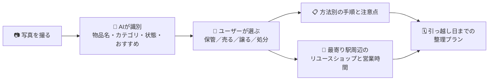

# ものさき。Monosaki

> **モノの次を、見つけよう。**
> 撮るだけで、引っ越し前の「これ、どうしよう？」が、今日やることに変わる。

[](https://www.youtube.com/watch?v=piaNsc6ilBI)
<!-- TODO: デモ動画の URL とサムネイル画像を差し替えてください -->

**▶ 公開中のアプリ：<https://jphack-kohl.vercel.app>**
（ログインには管理者が Supabase Auth で発行したアカウントが必要です。審査用アカウントは提出フォームをご確認ください）
<!-- TODO: 審査員がすぐ触れるよう、審査用アカウントを用意して提出フォームに記載してください -->

<p align="center">
  
  
  
</p>
<p align="center"><sub>左から：持ち物一覧と進捗 ／ AIのおすすめと整理プラン ／ 駅周辺のリユースショップ（営業時間つき）</sub></p>

---

## 30秒でわかる「ものさき。」

| | |
| --- | --- |
| **誰のため？** | 寮・シェアハウス・アパートから引っ越す、一人暮らしの学生や新社会人 |
| **何が大変？** | 持ち物ひとつひとつについて「持っていく・売る・譲る・捨てる」を決め、売り先や処分方法を調べ、期限までに片付けること |
| **何ができる？** | 写真を撮る → AI が物を識別して整理方法を提案 → 選んだ方法に合わせた手順と最寄り駅周辺のリユースショップを表示 → 引っ越し日までのタスクプランに自動でまとまる |
| **ここが違う** | AI に「断定させない」設計。確認済みの情報と未確認の情報をはっきり分けて表示し、最後の判断はユーザーが行う |

---

## 製品概要

### 背景（製品開発のきっかけ、課題等）

引っ越しの準備で本当に大変なのは、荷造りそのものよりも、その前の **「判断」と「調べもの」** です。

- 机、本、家電、服……。持ち物の数だけ「持っていく？売る？譲る？捨てる？」という判断が待っています。
- 売るなら、どこの店が買い取ってくれるのか。何時まで営業しているのか。
- 捨てるなら、粗大ごみなのか、リチウムイオン電池が入っていて特別な出し方が必要なのか。
- そして全部を引っ越し日までに終わらせなければなりません。

情報はフリマアプリ、自治体のサイト、地図アプリ、メモ帳にバラバラに散らばっています。調べるのが面倒になって判断を先送りし、気づけば退去前日に慌てて全部を処分してしまう。まだ使える物が、ごみになってしまいます。

私たちは、この **「判断の先送り」こそが、引っ越しで物が捨てられてしまう原因** だと考えました。

### 製品説明（具体的な製品の説明）

「ものさき。」は、**写真1枚から持ち物の「次の行き先」を決め、引っ越し日までの行動計画に変える** Web アプリです。名前は「モノの行き先」に由来します。



スマートフォンのブラウザーから使え、アプリのインストールは必要ありません。

### 特長

#### 1. 撮るだけで、AI が「これは何で、どうするのがいいか」を提案

写真をアップロードすると、Qwen の画像認識モデルが **物品名・カテゴリ・状態（5段階）・観察内容・おすすめの整理方法** を返します。AI の識別結果はその場で訂正できるため、誤認識があっても先へ進めます。

#### 2. 選んだ方法に合わせて、次の一歩とお店を案内

「保管する」「売る」「譲る」「処分する」の中からユーザーが選ぶと、方法ごとの手順と注意点を表示します。リチウムイオン電池を含む物や大型家具など、扱いに注意が必要なケースには個別の注意を出します。

「売る」を選んだ場合は、**東京都内 656 駅** から最寄り駅を選ぶだけで、駅から 3km 以内のリユースショップを距離順に表示します。自治体オープンデータで **買取対応を確認できた店** と、OpenStreetMap 由来の **未確認の候補** は、ラベルを分けて表示します。営業日・営業時間も、`Mo-Su 11:00-20:00` のような OSM の記法を **「月〜日 11:00〜20:00」** に変換して表示します。

#### 3. 持ち物ごとの判断が、引っ越し日までのプランにまとまる

整理方法を決めた持ち物は一覧で進捗を管理できます（未整理・対応中・完了）。ボタンを押すと、保存済みの整理内容から AI が **引っ越し日から逆算した準備タスク** を作成します。持ち物や整理方法を変更すると、古くなったプランを自動で検知して更新を促します。

### 解決出来ること

- **判断の先送りをなくす**：撮った瞬間に選択肢と次の一歩が見えるため、「あとで調べよう」が減ります。
- **調べものを一か所に**：手順、注意点、近くの店、営業時間、引っ越し日までのタスクが、ひとつの画面の流れの中でそろいます。
- **まだ使える物を次の持ち主へ**：売る・譲るという選択肢を、捨てるのと同じくらい手軽にします。
- **やり残しを防ぐ**：持ち物ごとの進捗と引っ越し日までのタスクで、未対応の物がひと目でわかります。

### 既存サービスとの違い

| | 売り先探し | 処分方法 | 持ち物全体の進捗管理 | 引っ越し日までの計画 | 情報の確度表示 |
| --- | :---: | :---: | :---: | :---: | :---: |
| フリマアプリ | ◯（出品） | − | − | − | − |
| 自治体のごみ分別アプリ | − | ◯ | − | − | ◯ |
| ToDo・チェックリストアプリ | − | − | △（手入力） | △（手入力） | − |
| 汎用の生成 AI チャット | △ | △ | − | △（保存されない） | − |
| **ものさき。** | **◯（駅周辺の店）** | **◯（注意点を案内）** | **◯** | **◯（AI が作成）** | **◯（確認済み／未確認を区別）** |

「ものさき。」は **個別の手段を置き換えるのではなく、持ち物ひとつひとつの判断をつなぐ「ハブ」** として機能します。

### 今後の展望

- **自治体ルールとの連携**：住んでいる区市町村ごとの粗大ごみ・回収ルールを公式情報に基づいて案内する。
- **対応エリアと店舗情報の拡充**：東京都以外の駅・リユースショップへ広げ、買取対応の確認状況と鮮度を高める。
- **「譲る」をもっと簡単に**：寮やシェアハウスの住人、後輩への譲渡など、身近な次の持ち主とつなぐ。
- **リマインダーと共有**：引っ越し日や進捗に合わせた通知、同居人とのプラン共有。

### 注力したこと（こだわり等）

**「AI に嘘をつかせない」ことを、最優先の設計方針にしました。**

引っ越しの判断を誤ると、お金や手間が失われます。だからこそ、AI がもっともらしいけれど間違った情報を出すことを、仕組みで防ぎました。

- **最終判断はユーザー**：AI のおすすめと、ユーザーが選んだ整理方法を別々に保存します。AI は提案するだけです。
- **確認済みと未確認を混ぜない**：買取対応を公式データで確認できた店と、OSM 由来の候補を別のテーブル・別の UI で扱い、「買取サービス未確認」と明示します。
- **根拠のない日付・ルールを出さない**：AI が作った引っ越しプランは、Zod スキーマで検証します。存在しない持ち物へのタスク、整理方法の食い違い、AI が作り出した具体的な日付を含むプランは受け付けません。
- **古い情報を使い続けさせない**：プランの元になった持ち物データをハッシュで記録し、内容が変わったら古いプランを自動で隠して更新を促します。
- **推測で埋めない**：営業時間がわからない店は「OSM に営業時間タグなし」と正直に表示し、推測した値を出しません。

---

## 開発技術

### 活用した技術

#### API・データ

- **Qwen / Alibaba Cloud Model Studio**：写真からの物品認識（Vision モデル）と、引っ越しタスクの生成（Text モデル、JSON 構造化出力）
- **Supabase**：メール認証、PostgreSQL、持ち物画像のプライベートストレージ、Row Level Security によるユーザーごとのアクセス制御
- **東京都の区市町村リユース事業者オープンデータ**：買取対応の確認と営業日・営業時間（CC BY 4.0）
- **国土交通省 国土数値情報「鉄道 N02 2025」**：駅データ（CC BY 4.0）
- **OpenStreetMap / Geofabrik Kantō**：リユースショップ候補と営業時間タグ（ODbL 1.0、© OpenStreetMap contributors）

#### データ規模（Supabase に格納済み）

| データ | 件数 |
| --- | ---: |
| 駅（東京都内） | 656 |
| 自治体オープンデータのリユース事業者 | 36（うち買取対応を確認済み 8） |
| 駅と事業者の距離対応 | 834 |
| OSM リユースショップ候補 | 1,711（うち営業時間タグあり 279） |
| 駅と OSM 候補の距離対応 | 19,538 |

#### フレームワーク・ライブラリ・モジュール

- Next.js 16（App Router）、React 19、TypeScript
- Supabase JavaScript SDK、`@supabase/ssr`
- Zod：API 入力、AI の応答、保存データの検証
- `@json-render/core` / `@json-render/react`：ルール評価の結果をカタログ化した UI コンポーネントで描画
- Vitest（20 ファイル・126 テスト）、ESLint
- Vercel（ホスティング）

#### デバイス

- スマートフォン、タブレット、PC の Web ブラウザー（モバイルファースト設計）
- スマートフォンのカメラで撮影した写真、または端末内の画像

### 独自技術

#### ハッカソンで開発した独自機能・技術

すべての機能は Hack Day 期間中（2026年10月17日〜18日）に開発しました（10月4日の Initial commit は JPHACKS のテンプレートのみです）。

| 独自技術 | 内容 | 主な実装 / commit |
| --- | --- | --- |
| **写真 → 判断 → 行動をつなぐ整理フロー** | AI の識別結果、ユーザーの選択、方法別の案内、店舗検索を一つの流れに統合 | [InventoryConsultFlow.tsx](./src/components/inventory/InventoryConsultFlow.tsx)、[ルールエンジン](./src/server/rules/engine.ts) / `da29e9a` `1c0a24b` |
| **AI 出力の検証ゲート** | 引っ越しプランを Zod で検証し、対象外の持ち物・方法の不一致・根拠のない日付・重複タスクを拒否 | [move-plan.ts](./src/server/move-plan.ts) / `0ce6dc4` |
| **古いプランの自動検知** | 持ち物データのスナップショットを SHA-256 でハッシュ化し、入力の変化を検知 | [move-plan.ts](./src/server/move-plan.ts) / `728a945` |
| **確度を分けた店舗データ基盤** | 自治体オープンデータ（確認済み）と OSM 候補（未確認）を別テーブルに分け、656 駅との距離を事前計算 | [supabase-provider.ts](./src/server/rules/providers/supabase-provider.ts)、[取り込みスクリプト](./scripts/) / `543c6f3` |
| **OSM 営業時間の補完と日本語化** | 店名と座標（100m 以内）で OSM と照合して営業時間を補完し、OSM 記法を日本語に変換 | [enrich_opening_hours.py](./scripts/enrich_opening_hours.py)、[osm-opening-hours.ts](./src/lib/osm-opening-hours.ts) / `e691303` `7b38dc0` |
| **オープンデータの還元** | OSM 由来の候補と駅距離を、出典・ライセンス付きの機械可読 JSON として公開 | [OSM データ公開 API](./src/app/api/open-data/osm-candidates/route.ts) / `543c6f3` |

#### 製品に取り入れた研究内容（データ・ソフトウェアなど）

- 国土交通省の駅データ、東京都の区市町村リユース事業者データ、OpenStreetMap の地物データという **出典もライセンスも異なる 3 種類のオープンデータを統合** し、出典ごとの確度とライセンス条件を保ったまま一つのサービスで使えるようにしました。

---

## はじめかた

```bash
npm ci
cp .env.local.example .env.local   # Supabase と Qwen の値を設定
npm run dev                        # http://localhost:3000
```

```bash
npm run typecheck && npm run lint && npm test
```

Supabase の migration、データの取り込み、OSM 営業時間の補完、ライセンスの扱いなどの詳細は **[セットアップとデータ運用ガイド](./docs/SETUP.md)** を参照してください。

## データの出典とライセンス

- 駅データ：国土交通省 国土数値情報「鉄道 N02 2025」（CC BY 4.0）
- リユース事業者データ：東京都内の各区市町村が公開するオープンデータ（CC BY 4.0）
- 店舗候補・営業時間：© [OpenStreetMap contributors](https://www.openstreetmap.org/copyright)、[ODbL 1.0](https://opendatacommons.org/licenses/odbl/1-0/)（Geofabrik Kantō 抽出データ）

OSM 由来の候補は店名・位置・分類タグにもとづく調査の手がかりであり、買取サービス・営業状況・対象商品を独立に確認したものではありません。
