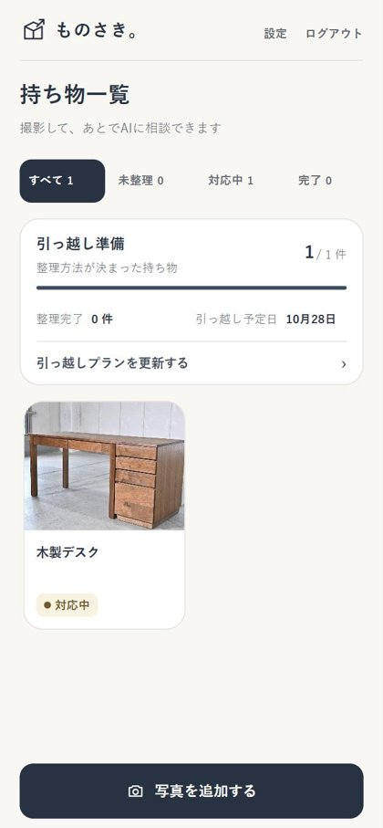
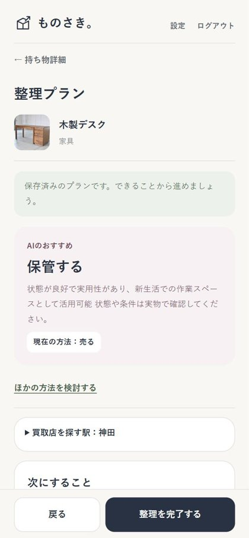
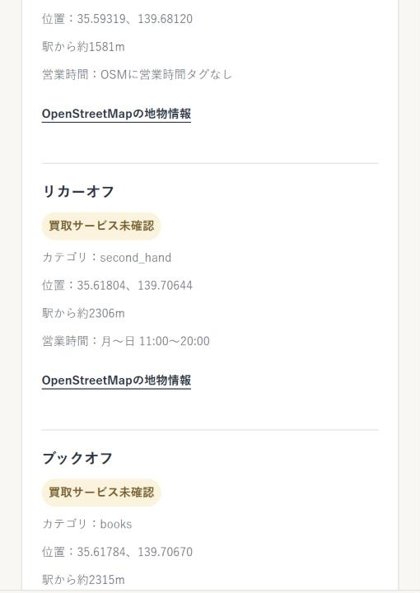
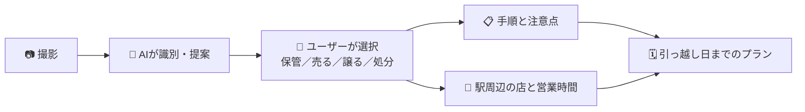

# ものさき。Monosaki

> **モノの次を、見つけよう。** 撮るだけで、引っ越し前の「これ、どうしよう？」が今日やることに変わる。

[](https://www.youtube.com/watch?v=piaNsc6ilBI)
<!-- TODO: デモ動画の URL とサムネイル画像を差し替えてください -->

**▶ アプリ：<https://jphack-kohl.vercel.app>**（審査用アカウントは提出フォームをご確認ください）
<!-- TODO: 審査用アカウントを用意して提出フォームに記載してください -->

<p align="center">
  
  
  
</p>

## 製品概要

### 背景（製品開発のきっかけ、課題等）

一人暮らしの学生や新社会人が寮・アパートを出るとき、大変なのは荷造りより **持ち物ごとの「判断」と「調べもの」** です。「持っていく？売る？譲る？捨てる？」を決め、売り先や処分方法を調べる。情報はフリマアプリ、自治体サイト、地図アプリに散らばっていて、判断を先送りした結果、退去直前にまだ使える物まで捨ててしまいます。

### 製品説明（具体的な製品の説明）

写真1枚から持ち物の **「次の行き先」** を決め、引っ越し日までの行動計画に変える Web アプリです。



### 特長

#### 1. 撮るだけで AI が提案

写真から物品名・カテゴリ・状態（5段階）・おすすめの整理方法を提案します。識別結果はその場で訂正できます。

#### 2. 次の一歩とお店がわかる

選んだ方法に合わせて、手順と注意点（リチウムイオン電池、大型家具など）を表示します。「売る」を選ぶと、**東京都内 656 駅** から選んだ駅の 3km 以内にあるリユースショップを、営業時間（「月〜日 11:00〜20:00」の形式）とあわせて距離順に表示します。

#### 3. 引っ越し日までのプランに自動でまとまる

持ち物ごとの進捗を管理し、AI が引っ越し日から逆算した準備タスクを作成します。持ち物が変わると、古くなったプランを検知して更新を促します。

### 解決出来ること

- 撮った瞬間に選択肢と次の一歩が見え、判断を先送りしなくなります。
- 手順・店・営業時間・タスクが一つの流れでそろいます。
- 「売る・譲る」を手軽にし、まだ使える物を次の持ち主へつなぎます。

### 既存サービスとの違い

| | 売り先 | 処分方法 | 進捗・計画 | 情報の確度表示 |
| --- | :---: | :---: | :---: | :---: |
| フリマアプリ | ◯ | − | − | − |
| 自治体のごみ分別アプリ | − | ◯ | − | ◯ |
| 汎用の生成 AI チャット | △ | △ | △（保存されない） | − |
| **ものさき。** | **◯** | **◯** | **◯** | **◯** |

### 今後の展望

- 区市町村ごとの粗大ごみ・回収ルールを公式情報に基づいて案内する
- 東京都以外の駅・店舗へ広げる
- 寮の後輩など、身近な人への「譲る」をサポートする

### 注力したこと（こだわり等）

**「AI に嘘をつかせない」設計** を最優先にしました。

- AI は提案するだけで、最終判断はユーザーが行います。
- 買取対応を確認済みの店と、OSM 由来の未確認候補を分けて表示します。
- AI が作ったプランは Zod で検証し、根拠のない日付や存在しない持ち物を含むものは受け付けません。
- 営業時間がわからない店は推測で埋めず、「タグなし」と表示します。

## 開発技術

### 活用した技術

#### API・データ

- **Qwen（Alibaba Cloud Model Studio）**：画像認識、引っ越しタスク生成
- **Supabase**：認証、PostgreSQL、画像ストレージ、Row Level Security
- **オープンデータ**：国土交通省 駅データ 656 駅、東京都区市町村のリユース事業者 36 件、OpenStreetMap のリユースショップ候補 1,711 件（駅との距離対応 19,538 件）

#### フレームワーク・ライブラリ・モジュール

- Next.js 16、React 19、TypeScript、Zod、`@json-render/react`、Vercel
- Vitest（126 テスト）、ESLint

#### デバイス

- スマートフォン・PC の Web ブラウザー（モバイルファースト）

### 独自技術

#### ハッカソンで開発した独自機能・技術

全機能を Hack Day（2026年10月17〜18日）中に開発しました（10月4日の Initial commit はテンプレートのみ）。

| 独自技術 | 主な実装 / commit |
| --- | --- |
| 写真 → 判断 → 行動をつなぐ整理フロー | [InventoryConsultFlow.tsx](./src/components/inventory/InventoryConsultFlow.tsx)、[engine.ts](./src/server/rules/engine.ts) / `da29e9a` |
| AI 出力の検証ゲートと、古いプランのハッシュ検知 | [move-plan.ts](./src/server/move-plan.ts) / `0ce6dc4` `728a945` |
| 確度を分けた店舗データ基盤（656 駅との距離を事前計算） | [supabase-provider.ts](./src/server/rules/providers/supabase-provider.ts) / `543c6f3` |
| OSM 営業時間の補完と日本語化 | [enrich_opening_hours.py](./scripts/enrich_opening_hours.py)、[osm-opening-hours.ts](./src/lib/osm-opening-hours.ts) / `e691303` `7b38dc0` |
| 出典・ライセンス付きオープンデータの公開 API | [osm-candidates/route.ts](./src/app/api/open-data/osm-candidates/route.ts) / `543c6f3` |

## はじめかた

```bash
npm ci && cp .env.local.example .env.local && npm run dev
```

詳細は [セットアップとデータ運用ガイド](./docs/SETUP.md) を参照してください。

## データの出典とライセンス

国土交通省 国土数値情報「鉄道 N02 2025」（CC BY 4.0）／東京都内区市町村のリユース事業者オープンデータ（CC BY 4.0）／© [OpenStreetMap contributors](https://www.openstreetmap.org/copyright)（[ODbL 1.0](https://opendatacommons.org/licenses/odbl/1-0/)）。OSM 由来の候補は、買取対応や営業状況を確認したものではありません。
